# Object-Oriented Programming (OOP) in C++ — Complete Guide & Architecture Notes

This repository submodule contains comprehensive implementations of Core Object-Oriented Programming (OOP) principles and Low-Level Design (LLD) fundamentals in C++.

---

## 📑 Table of Contents

1. [High-Level Architecture & Overview](#high-level-architecture--overview)
2. [Module 1: Encapsulation & Data Hiding (`encapsulation.cpp`)](#module-1-encapsulation--data-hiding-encapsulationcpp)
   - [Core Concept](#core-concept-1)
   - [Access Modifiers & Invariant Enforcement](#access-modifiers--invariant-enforcement)
   - [UML Class Diagram](#uml-class-diagram-1)
   - [Car State Lifecycle Diagram](#car-state-lifecycle-diagram)
   - [Execution Flow Pattern](#execution-flow-pattern-1)
3. [Module 2: Abstraction & Interface Design (`abstraction.cpp`)](#module-2-abstraction--interface-design-abstractioncpp)
   - [Core Concept](#core-concept-2)
   - [Pure Virtual Functions & Abstract Base Classes](#pure-virtual-functions--abstract-base-classes)
   - [Virtual Destructor Significance](#virtual-destructor-significance)
   - [UML Architecture Diagram](#uml-architecture-diagram-2)
   - [Dynamic Dispatch Flow](#dynamic-dispatch-flow-2)
4. [Module 3: Inheritance Patterns (`inheritance.cpp`)](#module-3-inheritance-patterns-inheritancecpp)
   - [Core Concept](#core-concept-3)
   - [Inheritance Access Specifiers Table](#inheritance-access-specifiers-table)
   - [The 5 Inheritance Architectures & UML Diagrams](#the-5-inheritance-architectures--uml-diagrams)
     - [1. Single Inheritance](#1-single-inheritance)
     - [2. Multilevel Inheritance](#2-multilevel-inheritance)
     - [3. Multiple Inheritance](#3-multiple-inheritance)
     - [4. Hierarchical Inheritance](#4-hierarchical-inheritance)
     - [5. Hybrid Inheritance](#5-hybrid-inheritance)
   - [Constructor & Destructor Invocation Order](#constructor--destructor-invocation-order)
5. [Module 4: The Diamond Problem & Virtual Inheritance (`diamondproblem.cpp`)](#module-4-the-diamond-problem--virtual-inheritance-diamondproblemcpp)
   - [Problem Breakdown & Ambiguity](#problem-breakdown--ambiguity)
   - [Memory Layout Comparison (Duplicate vs Virtual Base)](#memory-layout-comparison-duplicate-vs-virtual-base)
   - [The Virtual Inheritance Solution](#the-virtual-inheritance-solution)
   - [Virtual Base Class Construction Rule](#virtual-base-class-construction-rule)
6. [Module 5: Polymorphism Deep Dive (`polymorphism.cpp`)](#module-5-polymorphism-deep-dive-polymorphismcpp)
   - [Compile-Time (Static) Polymorphism](#compile-time-static-polymorphism)
     - [Function Overloading](#function-overloading)
     - [Operator Overloading](#operator-overloading)
   - [Run-Time (Dynamic) Polymorphism](#run-time-dynamic-polymorphism)
     - [Vptr and Vtable Internal Mechanics](#vptr-and-vtable-internal-mechanics)
     - [Multi-Class Implementation Flowchart](#multi-class-implementation-flowchart)
     - [Run-Time Type Information (RTTI) & Dynamic Downcasting](#run-time-type-information-rtti--dynamic-downcasting)
7. [OOP Pillars Comparison Matrix](#oop-pillars-comparison-matrix)
8. [Compilation & Execution Guide](#compilation--execution-guide)

---

## 🏛️ High-Level Architecture & Overview

The codebase is organized into five focused C++ programs demonstrating the foundational pillars of OOP and their low-level execution mechanics:

```
oops/
├── encapsulation.cpp   # Data hiding, state validation, getters & setters
├── abstraction.cpp     # Abstract contracts, pure virtual functions, virtual destructors
├── inheritance.cpp     # 5 types of inheritance hierarchies & code reuse
├── diamondproblem.cpp  # Multiple inheritance ambiguity & virtual inheritance fix
└── polymorphism.cpp    # Static (overloading) & dynamic (vtable/vptr, dynamic_cast) dispatch
```

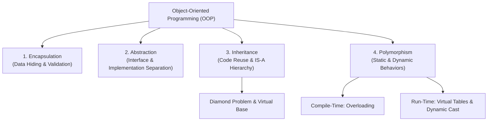

---

## 🔒 Module 1: Encapsulation & Data Hiding (`encapsulation.cpp`)

### Core Concept
**Encapsulation** is the bundling of data attributes and the methods that manipulate them into a single class unit, while restricting direct outside access to internal states (**Data Hiding**).

### Access Modifiers & Invariant Enforcement
In [`encapsulation.cpp`](file:///c:/Users/aradi/OneDrive/Documents/LLD/oops/encapsulation.cpp):
- **`private` Members**: `brand`, `topSpeed`, `model`, `currentGear`, `color`, `isEngineOn`, `currentSpeed`. Direct mutation from `main()` is blocked.
- **`public` Interface**: Controlled getters and guarded setters enforcing domain constraints:
  - `setCurrentSpeed(int cs)`: Enforces `0 <= cs <= topSpeed`.
  - `setCurrentGear(int cg)`: Enforces `1 <= cg <= 6`.
  - `stop()`: Invariant constraint prevents turning off engine unless `currentSpeed == 0`.
  - `accelerate()` and `brake()`: Invariant constraint ensures engine is active before speed changes.

### UML Class Diagram

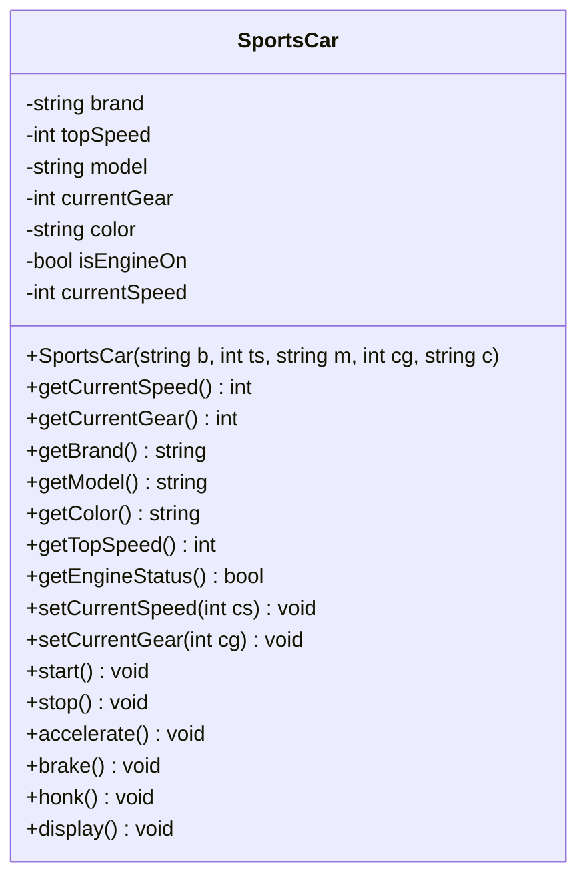

### Car State Lifecycle Diagram

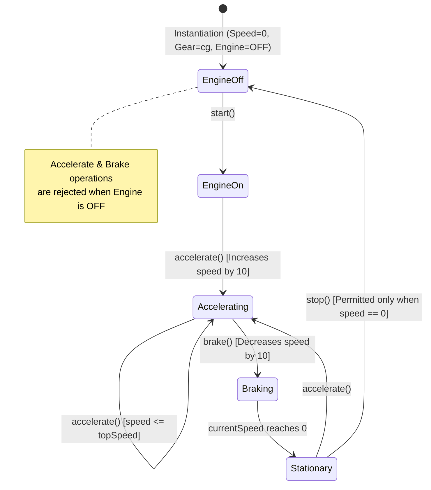

### Execution Flow Pattern

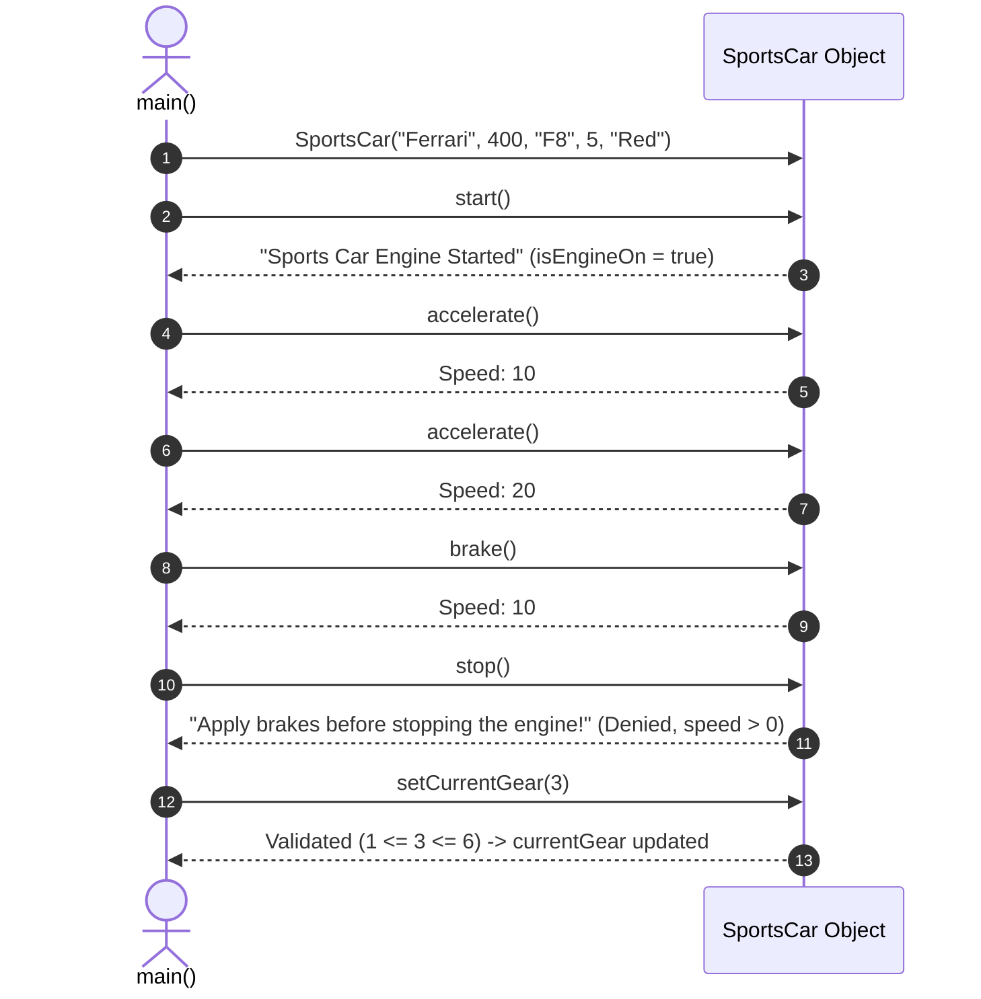

---

## 🎭 Module 2: Abstraction & Interface Design (`abstraction.cpp`)

### Core Concept
**Abstraction** focuses on exposing *what* an object does rather than *how* it does it. It hides internal implementation complexities behind a clear, minimal contract.

### Pure Virtual Functions & Abstract Base Classes
In [`abstraction.cpp`](file:///c:/Users/aradi/OneDrive/Documents/LLD/oops/abstraction.cpp):
- Class `Car` contains pure virtual functions (`virtual void start() = 0;`, `stop()`, `accelerate()`, `brake()`, `honk()`, `display()`).
- Because it has pure virtual functions, `Car` is an **Abstract Base Class (ABC)** and cannot be directly instantiated (`new Car()` causes compile error).
- `SportsCar` publicly inherits `Car` and implements every pure virtual function with the `override` specifier.
- The consumer interacts strictly with `Car*` pointer:
  ```cpp
  Car* myCar = new SportsCar("Ferrari", 400, "F8", 5, "Red");
  myCar->start();
  delete myCar;
  ```

### Virtual Destructor Significance

> [!IMPORTANT]
> When deleting an object of a derived class through a pointer to the base class, the base class **must** declare a `virtual` destructor:
> ```cpp
> virtual ~Car() {
>     cout << "Car Base Destructor Called" << endl;
> }
> ```
> Without `virtual`, only `~Car()` executes, bypassing `~SportsCar()`, resulting in **undefined behavior and memory leaks**. With `virtual`, destruction executes in bottom-up order:
> 1. `~SportsCar()`
> 2. `~Car()`

### UML Architecture Diagram

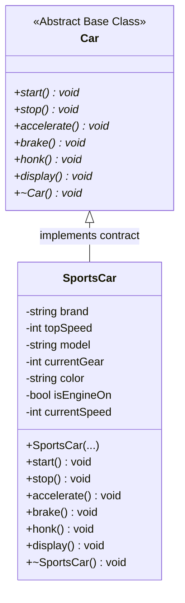

### Dynamic Dispatch Flow

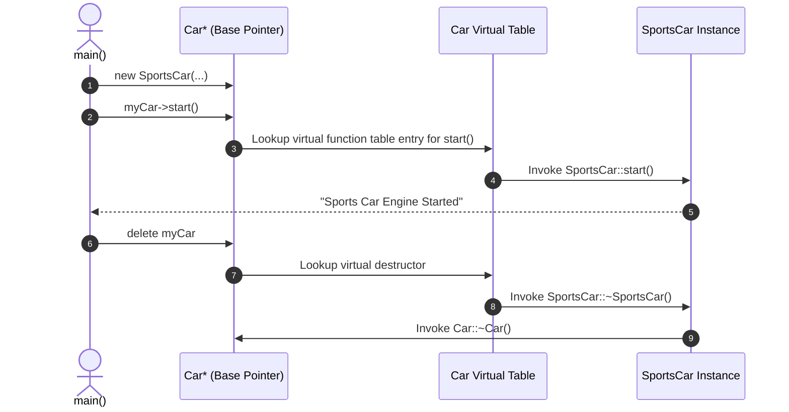

---

## 🧬 Module 3: Inheritance Patterns (`inheritance.cpp`)

### Core Concept
**Inheritance** establishes an **IS-A** relationship between classes, enabling code reusability and hierarchical type organization. A child (derived) class acquires properties and methods of its parent (base) class.

### Inheritance Access Specifiers Table

| Base Class Member Access | Inherited via `public` | Inherited via `protected` | Inherited via `private` |
| :--- | :--- | :--- | :--- |
| **`public`** | `public` in derived | `protected` in derived | `private` in derived |
| **`protected`** | `protected` in derived | `protected` in derived | `private` in derived |
| **`private`** | *Not accessible directly* | *Not accessible directly* | *Not accessible directly* |

### The 5 Inheritance Architectures & UML Diagrams

[`inheritance.cpp`](file:///c:/Users/aradi/OneDrive/Documents/LLD/oops/inheritance.cpp) showcases all 5 classic inheritance types:

#### 1. Single Inheritance
A derived class inherits from exactly one base class.
```
Person ───▶ Student
```
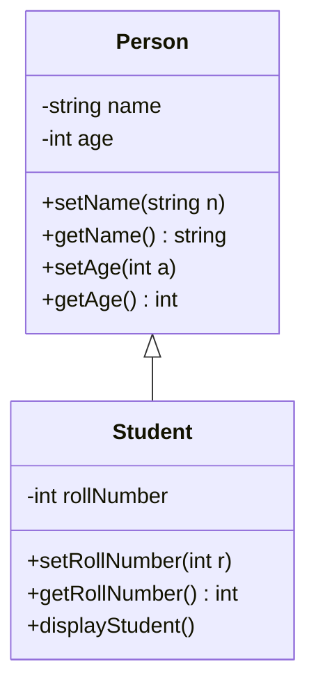

#### 2. Multilevel Inheritance
A class is derived from another derived class (forming an inheritance chain).
```
Person ───▶ Student ───▶ GraduateStudent
```
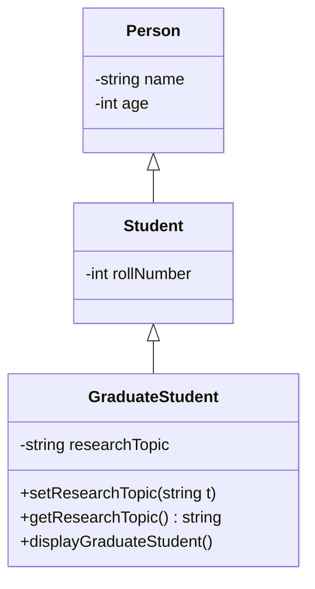

#### 3. Multiple Inheritance
A class inherits simultaneously from more than one base class.
```
Person       Sports
   │           │
   └───┬───────┘
       ▼
  SportsStudent
```
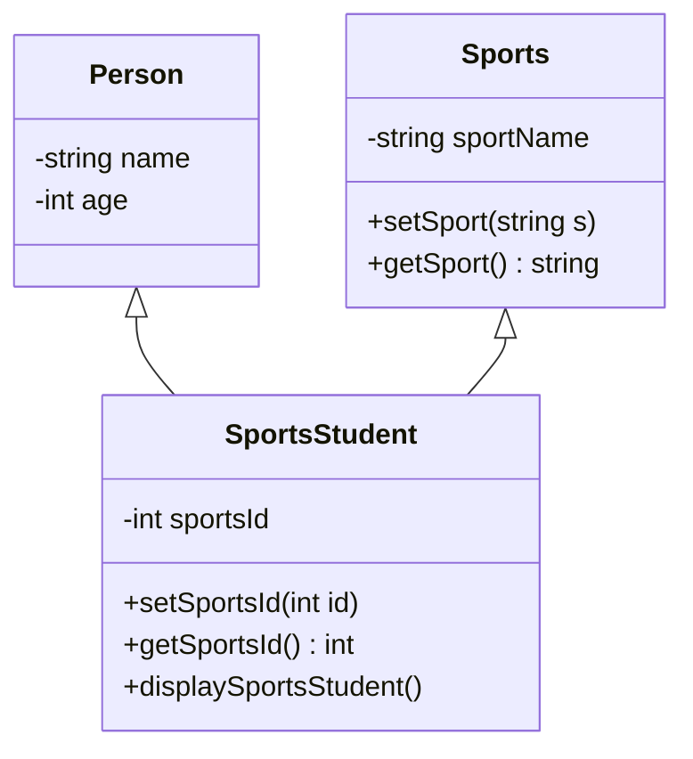

#### 4. Hierarchical Inheritance
Multiple classes inherit from a single common base class.
```
         Animal
        ┌───┴───┐
        ▼       ▼
       Dog     Cat
```
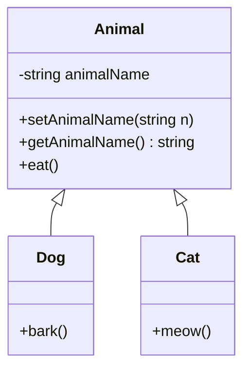

#### 5. Hybrid Inheritance
A combination of two or more inheritance styles (Hierarchical + Multiple), creating a diamond-like topology.
```
         Person
        ┌───┴───┐
        ▼       ▼
     Student  Teacher
        └───┬───┘
            ▼
     TeachingAssistant
```
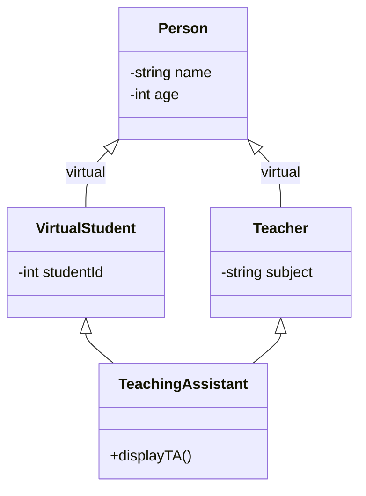

### Constructor & Destructor Invocation Order

```mermaid
flowchart TD
    subgraph Construction [Construction Order (Top to Bottom)]
        direction TB
        C1["1. Base Class Constructor: Person()"] --> C2["2. Intermediate Constructor: Student()"]
        C2 --> C3["3. Derived Constructor: GraduateStudent()"]
    end
    
    subgraph Destruction [Destruction Order (Bottom to Top)]
        direction TB
        D1["1. Derived Destructor: ~GraduateStudent()"] --> D2["2. Intermediate Destructor: ~Student()"]
        D2 --> D3["3. Base Class Destructor: ~Person()"]
    end
```

---

## 💎 Module 4: The Diamond Problem & Virtual Inheritance (`diamondproblem.cpp`)

### Problem Breakdown & Ambiguity

The Diamond Problem occurs in hybrid/multiple inheritance when two classes inherit from the same base class, and a fourth class inherits from both of them:

```
          Person (name)
          /           \
Student (name)     Teacher (name)
          \           /
    TeachingAssistant (name? name?)
```

In [`diamondproblem.cpp`](file:///c:/Users/aradi/OneDrive/Documents/LLD/oops/diamondproblem.cpp):
```cpp
// WITHOUT VIRTUAL INHERITANCE:
TeachingAssistant ta;
ta.setName("Aditya");    // COMPILE ERROR: Request for member 'setName' is ambiguous!
ta.displayName();        // COMPILE ERROR: Which Person::displayName() should be called?
```

### Memory Layout Comparison (Duplicate vs Virtual Base)

#### Standard Multiple Inheritance Layout (Duplicate Base Copies):
```
+------------------------------------+
| TeachingAssistant Object           |
|  +------------------------------+  |
|  | Student Subobject            |  |
|  |   +-----------------------+  |  |
|  |   | Person Subobject      |  |  |  <--- Copy #1: Person::name
|  |   |   name                |  |  |
|  |   +-----------------------+  |  |
|  |   rollNumber              |  |  |
|  +------------------------------+  |
|  +------------------------------+  |
|  | Teacher Subobject            |  |
|  |   +-----------------------+  |  |
|  |   | Person Subobject      |  |  |  <--- Copy #2: Person::name (Duplicate & Ambiguous!)
|  |   |   name                |  |  |
|  +------------------------------+  |
+------------------------------------+
```

#### Virtual Inheritance Layout (Shared Base Copy):
```
+------------------------------------+
| TeachingAssistant Object           |
|  +------------------------------+  |
|  | Student Subobject            |  |
|  |   vbptr (points to Person)   |  |
|  |   rollNumber                 |  |
|  +------------------------------+  |
|  | Teacher Subobject            |  |
|  |   vbptr (points to Person)   |  |
|  |   subject                    |  |
|  +------------------------------+  |
|  +------------------------------+  |
|  | Shared Single Person Object  |  |  <--- Exactly ONE copy of Person::name!
|  |   name                       |  |
|  +------------------------------+  |
+------------------------------------+
```

### The Virtual Inheritance Solution

By declaring `virtual public Person` in both `Student` and `Teacher`:
```cpp
class Person {
public:
    string name;
    Person(string n) : name(n) {}
};

class Student : virtual public Person {
public:
    Student() : Person("Student") {}
};

class Teacher : virtual public Person {
public:
    Teacher() : Person("Teacher") {}
};

class TeachingAssistant : public Student, public Teacher {
public:
    // TeachingAssistant directly initializes the shared virtual base
    TeachingAssistant() : Person("Aditya"), Student(), Teacher() {}
};
```

### Virtual Base Class Construction Rule

> [!NOTE]
> Under virtual inheritance, intermediate constructors (`Student()`, `Teacher()`) do **not** initialize the virtual base `Person`. 
> The **most derived class** (`TeachingAssistant`) is exclusively responsible for calling the virtual base class constructor. If omitted, the default constructor of `Person` is invoked.

---

## ⚡ Module 5: Polymorphism Deep Dive (`polymorphism.cpp`)

**Polymorphism** ("many forms") allows a single function name, operator, or base pointer to trigger different behavior based on context or runtime type.

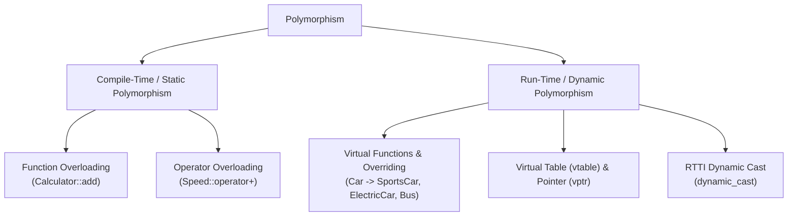

---

### Compile-Time (Static) Polymorphism

Resolved entirely at compile time. No runtime lookup overhead.

#### Function Overloading
Same function name with different parameter signatures (type, count, or order):
```cpp
class Calculator {
public:
    void add();                             // 0 args
    int add(int a, int b);                  // 2 ints
    int add(int a, int b, int c);           // 3 ints
    double add(double a, double b);         // 2 doubles
};
```
*Compiler mechanism:* **Name Mangling** generates unique internal symbol names (e.g., `_ZN10Calculator3addEii`).

#### Operator Overloading
Customizes standard operators for user-defined types:
```cpp
class Speed {
private:
    int speed;
public:
    Speed(int s) : speed(s) {}
    Speed operator+(Speed other) {
        return Speed(speed + other.speed);
    }
};

// Usage:
Speed s1(100), s2(150);
Speed s3 = s1 + s2; // Translates to s1.operator+(s2)
```

---

### Run-Time (Dynamic) Polymorphism

Resolved at runtime using virtual function tables. Enables generic code execution where a base pointer behaves according to the concrete derived object it addresses.

#### Vptr and Vtable Internal Mechanics

1. **Virtual Table (`vtable`)**: A static lookup table generated per class containing pointers to its virtual member functions.
2. **Virtual Pointer (`vptr`)**: A hidden pointer inserted into every object instance of a class with virtual functions, pointing to that class's `vtable`.

```
Car* car1 = new SportsCar("Ferrari", 400);
Car* car2 = new ElectricCar("Tesla");
Car* car3 = new Bus("Volvo");

car1->accelerate();   // Resolves via car1->vptr to SportsCar::accelerate
car2->accelerate();   // Resolves via car2->vptr to ElectricCar::accelerate
car3->accelerate();   // Resolves via car3->vptr to Bus::accelerate
```

```
[ car1 Instance ]               [ SportsCar vtable ]
+---------------+              +----------------------------+
| vptr          | ------------>| &SportsCar::start          |
| brand         |              | &SportsCar::accelerate     |
| topSpeed      |              | &SportsCar::brake          |
| currentSpeed  |              | &SportsCar::stop           |
+---------------+              | &SportsCar::~SportsCar     |
                               +----------------------------+

[ car2 Instance ]               [ ElectricCar vtable ]
+---------------+              +----------------------------+
| vptr          | ------------>| &ElectricCar::start        |
| brand         |              | &ElectricCar::accelerate   |
| battery       |              | &ElectricCar::brake        |
+---------------+              | &ElectricCar::stop         |
                               | &ElectricCar::~ElectricCar |
                               +----------------------------+
```

#### Multi-Class Implementation Flowchart

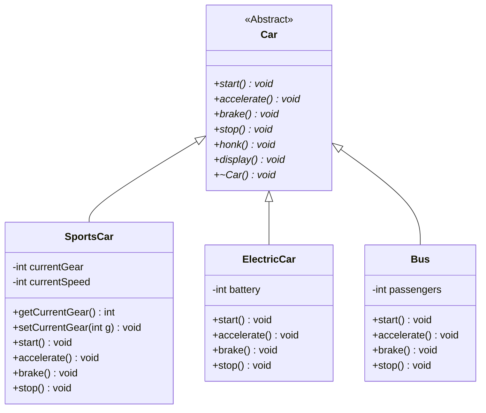

#### Run-Time Type Information (RTTI) & Dynamic Downcasting

Base class pointers only have access to functions declared in `Car`. When we need access to derived-specific members (`getCurrentGear()`, `setCurrentGear()`), we safely cast using `dynamic_cast`:

```cpp
Car* car1 = new SportsCar("Ferrari", 400);

// Safe downcast from Car* to SportsCar*
SportsCar* sports = dynamic_cast<SportsCar*>(car1);

if (sports != nullptr) {
    // Valid cast: car1 actually points to a SportsCar
    cout << "Current Gear: " << sports->getCurrentGear() << endl;
    sports->setCurrentGear(3);
} else {
    // Cast failed (returns nullptr for pointer types)
}
```

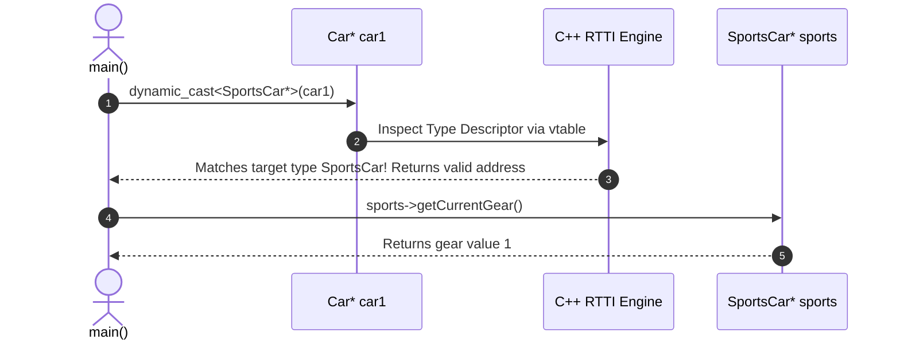

---

## 📊 OOP Pillars Comparison Matrix

| Pillar | Primary Purpose | How It Is Implemented | Example in Codebase |
| :--- | :--- | :--- | :--- |
| **Encapsulation** | Hide internal data, enforce state validity | `private` variables with `public` getters/setters | [`SportsCar::setCurrentSpeed()`](file:///c:/Users/aradi/OneDrive/Documents/LLD/oops/encapsulation.cpp#L80-L88) enforces `[0, topSpeed]` |
| **Abstraction** | Hide implementation details, expose contract | Pure virtual functions (`= 0`) in an Abstract Base Class | [`Car`](file:///c:/Users/aradi/OneDrive/Documents/LLD/oops/abstraction.cpp#L11-L39) contract with `start()`, `accelerate()`, `brake()` |
| **Inheritance** | Code reuse, model hierarchical IS-A relationships | Class derivation (`class Student : public Person`) | 5 patterns in [`inheritance.cpp`](file:///c:/Users/aradi/OneDrive/Documents/LLD/oops/inheritance.cpp) & virtual base fix in [`diamondproblem.cpp`](file:///c:/Users/aradi/OneDrive/Documents/LLD/oops/diamondproblem.cpp) |
| **Polymorphism** | Single interface for multiple forms | Function/operator overloading (static), `vtable`/`vptr` (dynamic) | [`Calculator::add()`](file:///c:/Users/aradi/OneDrive/Documents/LLD/oops/polymorphism.cpp#L18-L51), `Speed::operator+`, [`Car*` dispatch](file:///c:/Users/aradi/OneDrive/Documents/LLD/oops/polymorphism.cpp#L636-L715) |

---

## 🛠️ Compilation & Execution Guide

All files can be compiled using any modern C++ compiler (`g++`, `clang++`, or `MSVC`) with C++17 or C++20:

```powershell
# 1. Compile and run Encapsulation
g++ -std=c++17 -o encapsulation encapsulation.cpp
./encapsulation

# 2. Compile and run Abstraction
g++ -std=c++17 -o abstraction abstraction.cpp
./abstraction

# 3. Compile and run Inheritance
g++ -std=c++17 -o inheritance inheritance.cpp
./inheritance

# 4. Compile and run Diamond Problem resolution
g++ -std=c++17 -o diamond diamondproblem.cpp
./diamond

# 5. Compile and run Polymorphism
g++ -std=c++17 -o polymorphism polymorphism.cpp
./polymorphism
```
